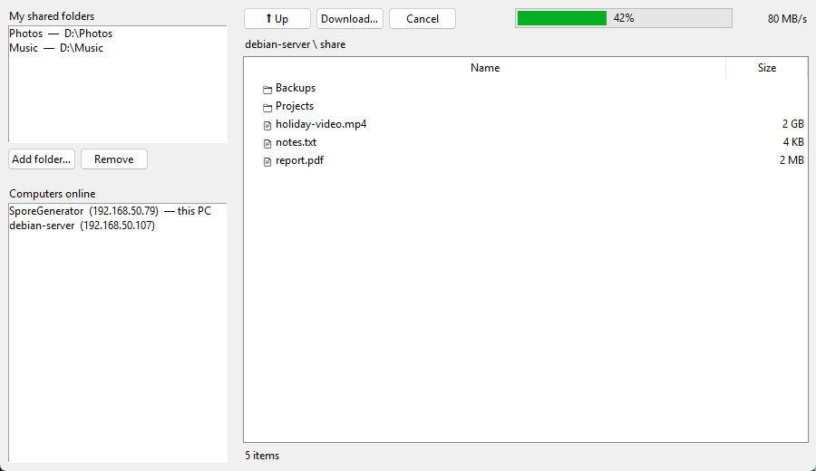

<div align="center">

# Mycelium

**Share folders between the computers on your home network: no setup, no accounts, no cloud.**



</div>

Run Mycelium on each PC and they find each other automatically. Pick the folders you want to share, click any computer in the list, and browse or download whatever it shares, single files or whole folders.

## Features

- 🔍 **Finds computers by itself.** PCs appear in the list within seconds of starting up and drop off when they go offline.
- 📁 **Choose exactly what to share.** Add or remove folders at any time. Nothing outside them is reachable.
- ⬇️ **Download files or whole folders** with a live progress bar, transfer speed and a cancel button.
- 🛡️ **Safe by design.** Other PCs can only read your shared folders, never change or delete anything. A download never overwrites an existing file, and a half-finished one never shows up under the real name.
- 🔄 **Updates itself.** Checks for new versions and offers to install them with one click.
- 🪟🐧 **Windows and Linux**, and they work together.

## Get started

**Windows:** download `Mycelium.exe` from the [latest release](https://github.com/Wizwo86/mycelium-releases/releases/latest) and run it. When Windows Firewall asks, allow it on **Private** networks.

**Linux:**
```bash
sudo apt install python3-tk
python3 mycelium.py
```
If a firewall is on, open ports **8765/tcp** and **8766/udp**.

> [!WARNING]
> There's no password. Anyone on your network who runs Mycelium can download from your shared folders, so use it on networks you trust.

## How it works

Each copy announces itself every few seconds with a small UDP broadcast on your local network, and listens for the others. To browse or download, it asks the other PC directly over HTTP. It's a single Python file with no dependencies beyond the standard library.

## Development

| | |
|---|---|
| Run from source | `py mycelium.py` |
| Run tests | `py test_mycelium.py` |
| Publish a release | bump `VERSION` in `mycelium.py`, then `.\release.ps1` |

Releases go to the public [mycelium-releases](https://github.com/Wizwo86/mycelium-releases) repo, which running copies check for updates. The updater stays off when running from this git checkout, so it never overwrites your working copy.

## License

[MIT](LICENSE): free to use, change and share.
